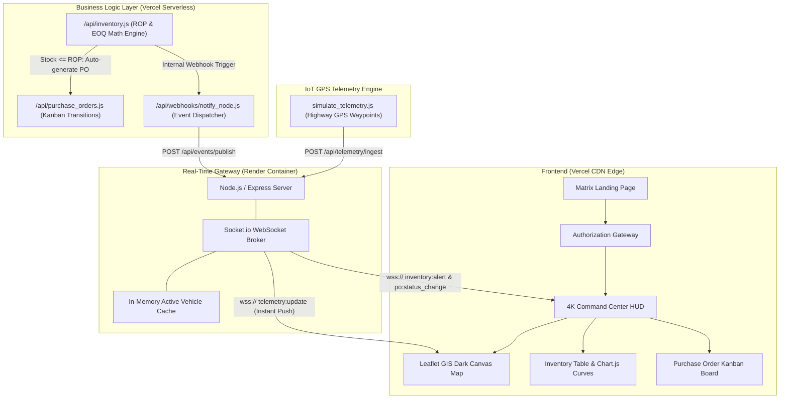
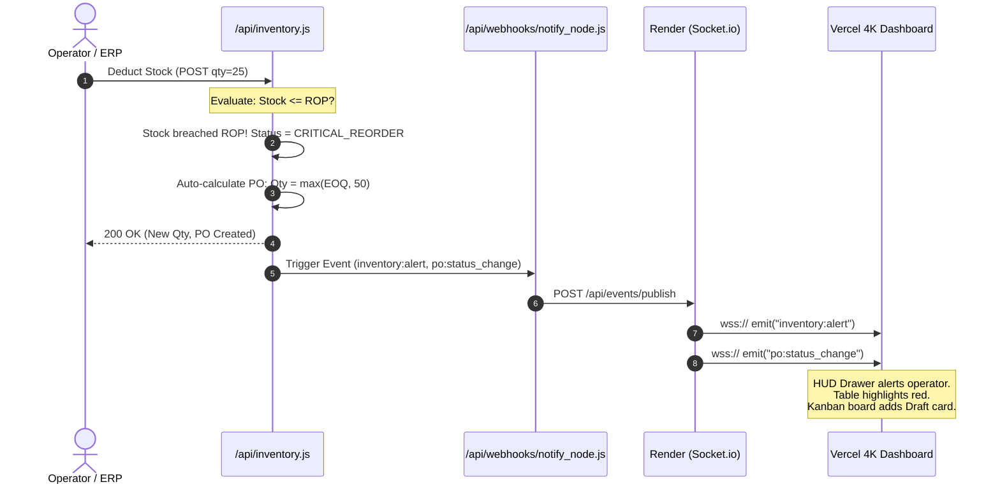

# Complete SCM 4K Command Center System Architecture & Viva Guide

---

## 1. The Core Problem Statement

In modern supply chain management and enterprise logistics, companies lose millions of dollars due to three systemic failures:

1. **The "Black Box" In-Transit Problem (Blind Logistics):**  
   Once cargo leaves a central warehouse, dispatchers often rely on periodic driver phone calls or delayed EDI check-ins. If a truck faces highway gridlock or mechanical breakdown, dispatch centers learn about it hours later, missing critical delivery windows.
2. **The "Stockout vs. Overstocking" Dilemma (Suboptimal Inventory):**  
   - If a warehouse orders **too little**, stock runs out, assembly lines halt, and customer orders fail (costly stockouts).
   - If a warehouse orders **too much**, huge amounts of working capital are frozen, and storage/holding costs skyrocket.
   - Most legacy systems rely on arbitrary human guesses rather than mathematically verified demand forecasting.
3. **Fragmented, Laggy Data Silos:**  
   Warehouse inventory managers, procurement teams, and transport dispatchers work on separate software systems. There is no single, unified, real-time command center where an inventory depletion immediately triggers a purchase order, updates a supplier, and tracks incoming transit on a single screen.

### Our Solution
We engineered the **Nexus SCM Real-Time 4K Command Center**—a cloud-native, event-driven platform that integrates:
* **Sub-second GIS Fleet GPS Telemetry** over WebSockets.
* **Automated Mathematical Replenishment** using Reorder Point (ROP) & Economic Order Quantity (EOQ).
* **An Interactive Kanban Procurement Pipeline** bridging stock depletions to automated Purchase Orders.
* **A High-Tech 4K Glassmorphism HUD** providing dispatchers with instantaneous situational awareness.

---

## 2. High-Level Architecture Flow



---

## 3. Deep-Dive: From Splash Screen to Command Center

### View 1: Dynamic "Initiate System" Landing Page
* **The Visual Experience:** When you open the application, you are greeted by an animated cyan-green Matrix rain stream over a deep obsidian backdrop (`#0b0f19`) with a futuristic glitch title: **NEXUS COMMAND CENTER**.
* **How It Works Under the Hood:**
  * It uses the native **HTML5 Canvas API** (`<canvas id="matrix-bg"></canvas>`).
  * In `public/js/app.js`, the canvas measures the viewport dimensions (`window.innerWidth`, `window.innerHeight`).
  * A string containing alphanumeric characters, mathematical operators, and symbols (`0123456789$+-*/=%...`) is split into vertical column drops.
  * Every 33 milliseconds, the render loop paints a translucent rectangle (`rgba(11, 15, 25, 0.05)`) over the previous frame, creating an optical phosphor decay (fading trail effect), before stamping the next glyph in neon cyan (`#00f3ff`).
  * Clicking **INITIALIZE SYSTEM** invokes `switchView('view-login')`, transitioning the UI seamlessly with zero browser reload.

### View 2: Authorized Access Control Screen
* **The Visual Experience:** A glowing glassmorphism login panel with frosted glass blur (`backdrop-filter: blur(16px)`), neon borders, and authorized personnel verification.
* **Under the Hood:**
  * Submits an asynchronous `POST` request to `/api/auth`.
  * Verifies credentials (`admin` / `password`).
  * **Critical Performance Optimization:** Once authentication succeeds, `clearInterval(matrixInterval)` is called to terminate the matrix canvas loop. This frees up 100% of GPU/CPU resources for rendering the 4K telemetry charts and the interactive GIS map.

---

## 4. Deep-Dive: The Live GIS Telemetry Map

The map is the operational heart of the Command Center, implemented in `public/js/tracking.js` using **Leaflet.js**.

```
[GIS Map Architecture]
OpenStreetMap Raw Tiles
       │
       ▼ (CSS Invert & Hue Filters)
High-Tech Dark-Matter Tactical Canvas
       │
       ├──> Strategic Warehouse Beacons (Chicago ORD, Dallas DFW, LAX, Newark EWR)
       ├──> Interstate Freight Polylines (Dashed SVG Highway Corridors)
       └──> Dynamic Vehicle Markers (Rotating Directional Arrows + Live HUD Tooltips)
```

### 1. The High-Tech "Dark-Matter" Styling
Standard OpenStreetMap tiles are brightly colored (green parks, blue water, white roads), which clashes with a 4K dark command room. Instead of paying for costly proprietary Mapbox keys, we used standard OpenStreetMap tiles and transformed them into a dark canvas using pure CSS hardware-accelerated filters:
```css
#gis-map .leaflet-tile-pane {
  filter: invert(100%) hue-rotate(180deg) brightness(85%) contrast(120%);
}
```
This converts the map into a deep navy-black canvas where neon routes and markers pop out with crisp clarity.

### 2. Strategic Logistics Hubs
Warehouses are plotted at exact geographic coordinates:
* **Chicago Apex Hub (ORD-01):** `[41.9742, -87.9073]`
* **Dallas SuperCenter (DFW-02):** `[32.8998, -97.0403]`
* **Ontario Depot (LAX-03):** `[34.0537, -117.5982]`
* **Newark Port Facility (EWR-04):** `[40.6895, -74.1745]`

Each warehouse uses a custom `L.divIcon` displaying a pulsing emerald beacon (`.custom-hub-marker`). Clicking a hub opens a custom dark HUD popup showing warehouse code, operational name, and location.

### 3. Animated Vehicle Markers & Directional Heading
* Each vehicle is rendered using an SVG chevron arrow inside a `vehicle-div-wrapper`.
* **Dynamic Orientation:** When the truck turns, the SVG rotates dynamically to match the truck's actual bearing using inline CSS transforms:
  ```javascript
  style="transform: rotate(${heading}deg);"
  ```
* **Color-Coded Status:**
  * **Neon Cyan (`#00f3ff`):** Vehicle on schedule (`In Transit`).
  * **Crimson Red (`#ef4444`):** Vehicle experiencing transport hazards or delays (`Delayed`).

### 4. Polyline Highway Corridors
Active routes are traced across major US interstate corridors (e.g., I-80, I-35, I-10) using `L.polyline`. Routes are styled with semi-transparent cyan dashed strokes (`dashArray: '6, 8'`), displaying the planned trajectory between source and destination hubs.

### 5. How Live GPS Data Reaches the Map (The Streaming Pipeline)
1. The CLI simulation script (`simulate_telemetry.js`) reads GPS waypoints along freight routes.
2. Every 1.2 seconds, it sends a payload to Render:
   ```json
   {
     "shipment_id": 1,
     "tracking_number": "TRK-MAE-800001",
     "lat": 41.258,
     "lng": -88.542,
     "speed": 62.4,
     "heading": 215,
     "status": "In Transit"
   }
   ```
3. The Render server caches the coordinates in `activeVehicleCache` and fires a WebSocket broadcast: `io.emit('telemetry:update', payload)`.
4. In the browser, `telemetryRadar.on('telemetry:update')` catches the packet and calls `trackerMap.renderOrUpdateVehicle(data)`.
5. The map updates the existing marker with `marker.setLatLng([lat, lng])` and rotates the arrow smoothly **without redrawing the map or flickering**.

---

## 5. Inventory Analysis & Mathematical Models

Rather than using arbitrary alerts, the system executes two classical industrial engineering formulas inside `api/inventory.js`:

### 1. Reorder Point (ROP) — *"When to Order"*
The Reorder Point represents the inventory level that triggers a replenishment order so that new stock arrives just as safety stock is reached:

$$\text{ROP} = (\text{Daily Demand Rate} \times \text{Supplier Lead Time}) + \text{Safety Stock}$$

$$\text{Safety Stock} = Z \times \sqrt{\text{Lead Time}} \times \sigma_d$$

* **Daily Demand Rate ($d$):** Units consumed per operational day.
* **Lead Time ($L$):** Number of days required for the supplier to manufacture and ship the items.
* **$Z$-Score (Service Level):** We chose $Z = 1.65$, which corresponds to a **95% service level**, ensuring only a 5% statistical probability of stockout during supplier lead time.
* **$\sigma_d$:** Standard deviation of daily demand.

### 2. Economic Order Quantity (EOQ) — *"How Much to Order"*
The EOQ (Wilson Formula) calculates the optimal order size that minimizes total inventory costs by finding the mathematical equilibrium between **holding costs** and **ordering costs**:

$$\text{EOQ} = \sqrt{\frac{2 \times D \times S}{H}}$$

* **$D$ (Annual Demand):** Total number of units required per year.
* **$S$ (Order Cost):** Fixed administrative and shipping cost incurred every time an order is placed.
* **$H$ (Holding Cost):** Annual cost of storing, insuring, and handling one unit in the warehouse.

```
Inventory Cost Curve:
Cost
  ▲             / Total Cost (Minimum at EOQ)
  │ \          /
  │  \  EOQ   /   Holding Cost (H * Q / 2)
  │   \  ▼   /
  │    \____/
  │     \  /  Ordering Cost (S * D / Q)
  └───────┴────────────────────────► Order Quantity (Q)
```

### 3. Stock Health Classifications
Every SKU in the inventory table is categorized into real-time health tiers:
* **`OPTIMAL` (Emerald Badge):** Current stock $> \text{ROP}$. Safe operational buffer.
* **`LOW_STOCK` (Amber Badge):** Current stock $\le \text{ROP}$. Replenishment needed.
* **`CRITICAL_REORDER` (Pulsing Crimson Badge):** Current stock $< 70\%$ of $\text{ROP}$. Urgent replenishment triggered.
* **`OUT_OF_STOCK` (Solid Red Badge):** Stock $= 0$. Critical disruption alert.

### 4. Chart.js Visual Telemetry
In `public/js/charts.js`:
* **Dual-Axis Bar & Line Chart:** Displays on-hand inventory levels for every SKU (cyan vertical bars) contrasted directly against a horizontal red dashed threshold representing the **Reorder Point**. If any bar drops below the dashed line, it visually alerts the operator.
* **Donut Chart:** Renders the proportional health breakdown of the entire warehouse network (Optimal vs Low vs Critical).

---

## 6. The Automated Procurement Pipeline (Kanban Flow)



### The Kanban Stages
1. **Draft (Auto-Generated):** Automatically spawned when ROP is breached with the exact EOQ batch quantity.
2. **Issued:** Procurement officer verifies supplier pricing and issues the PO to the vendor.
3. **In Transit:** The vendor dispatches freight; shipping coordinates bind to the GIS tracking map.
4. **Received:** Shipments arrive at the warehouse loading dock, stock is replenished, and the item's status resets to `OPTIMAL`.

Operators can advance any order simply by clicking its Kanban card in the command center.

---

## 7. How We Made the System Truly Dynamic

Many student projects are "static"—they look like dashboards, but only show static mock tables that never update unless manually refreshed. Here is how our architecture achieves genuine real-time dynamicity:

1. **Decoupled Event Gateway:**  
   Vercel handles edge assets, while Render maintains persistent bi-directional WebSockets (`Socket.io`). State changes broadcast instantly across the network.
2. **Reactive DOM Updates:**  
   When a WebSocket packet arrives (`telemetry:update` or `inventory:alert`), the browser dynamically updates only the affected DOM nodes or markers without re-rendering the entire page.
3. **Continuous Radar Ping-Pong:**  
   Every 4 seconds, the client sends a `hud:ping` timestamp to Render, which bounces back a `hud:pong`. The round-trip time ($\Delta t = t_{\text{client}} - t_{\text{sent}}$) updates the live HUD latency in milliseconds (e.g., `38ms`).
4. **Simulation Engine:**  
   A background CLI runner (`simulate_telemetry.js`) feeds live GPS telemetry packets along real highway corridors into Render, causing vehicles to traverse the continental US in real time.
5. **Dynamic Service Binding:**  
   `public/js/websocket.js` supports dynamic connection strings via URL parameters (`?node=...`), browser `localStorage`, or environment defaults, allowing the system to run in the cloud or on local networks.

---

## 8. Summary: How This Solves the Problem Statement

| Problem in Traditional SCM | How Our Command Center Solves It | Technical Implementation |
| :--- | :--- | :--- |
| **Blind In-Transit Freight** | Sub-second GIS map updates showing exact vehicle position, speed, heading, and delays. | Leaflet.js + Socket.io GPS packet streaming over WebSockets. |
| **Frequent Stockouts** | Mathematical Reorder Point triggers replenishment *before* stock runs dry. | $ROP = (d \times L) + (1.65 \times \sqrt{L} \times \sigma_d)$ in `/api/inventory.js`. |
| **Excess Holding Costs** | Orders are batched at mathematically optimal cost curves. | Wilson EOQ Formula $\sqrt{\frac{2DS}{H}}$ calculates exact order size. |
| **Delayed Procurement** | Eliminates manual paperwork by auto-generating Draft POs the instant ROP is breached. | Automated event-driven PO creation linked to Kanban board. |
| **Fragmented Systems** | All data (fleet, stock, POs, latency) unifies on a single 4K command screen. | Glassmorphism SPA + Event Bus on Vercel & Render. |

---

## 9. 2-Minute Viva Speech Script

If the examiner asks: *"Give me an end-to-end walkthrough of what you built and how it works"*, speak this confidently:

> *"Respected Examiners, our project addresses the core challenge of modern supply chain management: **lack of real-time visibility and delayed inventory replenishment**.*
>
> *We built the **Nexus SCM 4K Command Center** using a decoupled cloud architecture: our frontend and serverless APIs run on **Vercel**, while our real-time telemetry gateway runs on **Render** using **Node.js and Socket.io**.*
>
> *When an operator logs into the Command Center, they see three synchronized layers:*
> 1. *First, our **GIS Fleet Tracking Map** built with Leaflet.js, which receives live GPS coordinates and directional heading over WebSockets from our simulation engine, rendering animated vehicle markers along transport corridors.*
> 2. *Second, our **Inventory Intelligence Engine**, which monitors stock levels against mathematically computed **Reorder Points (ROP)** using a 95% service level.*
> 3. *Third, our **Automated Procurement Kanban Board**. The moment an item's stock drops below its Reorder Point, the system automatically calculates the **Economic Order Quantity (EOQ)** to balance ordering and holding costs, generates a new Purchase Order, and broadcasts the alert over WebSockets to all connected command center screens without requiring a page refresh.*
>
> *By combining WebSockets with classical operational management formulas, we eliminate blind transit spots and prevent both stockouts and overstocking."*
